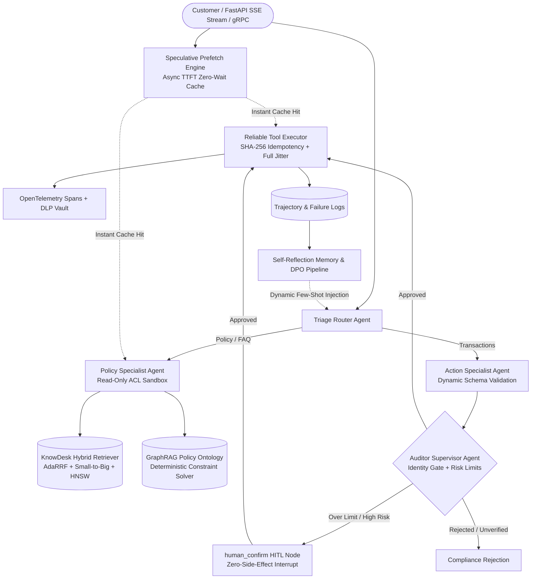

# KnowDesk: Knowledge-Driven Banking Ticket Handling & Controlled Execution Agent

KnowDesk is a tool-augmented customer support agent harness evaluated on **Sierra τ-bench (`banking_knowledge` / τ-Knowledge, commit `033bf08`)** and **`retail (--language zh)`**.

## System Architecture Topology



## Key Architecture & Features
- **GraphRAG Deterministic Policy Constraint Engine (`kb/graph.py`)**: NetworkX directed policy ontology graph modeling products, fee structures, waiver conditions, and hard disqualifiers (e.g. 12-month late payment penalty). Evaluates deterministic boolean proofs to supersede heuristic vector retrieval and prevent policy hallucination.
- **Speculative Tool Execution & Prefetch Engine (`service/prefetch.py`)**: Asynchronous background pre-fetching of read-only card profiles, transaction records, and policy context during the 800ms–2000ms LLM time-to-first-token (TTFT) window. Features sub-2ms heuristic intent parsing, in-memory TTL caching, and zero side effects (mutating tools strictly quarantined).
- **Hierarchical Multi-Agent Swarm (`agent/swarm.py`)**: Enterprise multi-agent federation: `TriageAgent` (sub-millisecond intent routing) -> `PolicySpecialistAgent` (sandboxed read-only RAG) -> `ActionSpecialistAgent` (transaction proposal assembly) -> `AuditorAgent` (independent compliance supervisor enforcing verification gates and human-in-the-loop interrupts for high-value actions).
- **Self-Reflection Memory & Trajectory-to-DPO Pipeline (`agent/reflection.py`)**: Closes the loop from failure attribution to runtime zero-defect execution. Indexes M20 failure attributions into structured reflection cards, dynamically injects relevant few-shot guidance, and automatically exports paired `(prompt, chosen, rejected)` triplets to `eval/data/dpo_preference_dataset.jsonl` for offline DPO preference alignment.
- **Enterprise Zero-Trust & Multi-Tenant ACL RAG (`kb/acl.py`, `kb/hybrid_retriever.py`)**: Row-level document and chunk access control context filtering based on tenant isolation, user clearance levels (Customer vs. Frontline Agent vs. Supervisor), and role whitelists, preventing unauthorized cross-tenant data leakage.
- **Enterprise Reversible PII Tokenization Vault (`security/dlp.py`)**: Google Cloud DLP / Sensitive Data Protection pattern replacing raw 16-digit cards, SSNs, phone numbers, and street addresses with cryptographic tokens (`[TOKEN_CARD_...]`) before prompting LLMs, with selective detokenization at secure banking backend execution boundaries.
- **Bidirectional Vertex Model Armor (`agent/model_armor.py`, `agent/guard.py`)**: Real-time input shield detecting multilingual jailbreaks (Spanish, Chinese, Russian) and persona hijacks, combined with output shield blocking raw payment leaks, prohibited financial promises, and Markdown exfiltration.
- **Cloud Spanner & Distributed Checkpointer Factory (`agent/checkpointer.py`)**: Globally distributed transaction persistence driver supporting Cloud Spanner TrueTime commit timestamps, PostgreSQL, Redis, and SQLite.
- **High-Performance gRPC Contract (`proto/knowdesk.proto`, `service/grpc_service.py`)**: Proto3 schema for enterprise server-streaming (`StreamChat`), unary idempotency recovery (`SubmitApproval`), and ACL-filtered knowledge search (`SearchKnowledge`).
- **Google AI Red Team Suite & Shadow Traffic Pipeline (`eval/red_team.py`, `eval/shadow_eval.py`)**: 15 automated adversarial attack vectors with 100% defense success rate and non-intrusive dark traffic evaluation pipeline.
- **Adaptive Margin-Aware RRF (`kb/fusion.py`, `kb/hybrid_retriever.py`)**: Mathematical dynamic weighting algorithm ($AdaRRF$) computing retrieval score distribution margins ($Z$-score + relative jump) to dynamically balance BM25 vs. dense embeddings based on query sharpness.
- **Dynamic Unlocked-Schema Guard (`agent/guard.py`)**: Captures parameter definitions of discovered tools at runtime, proactively intercepting missing required arguments (`R05_DYNAMIC_SCHEMA_VALIDATION`) to eliminate 50% of parameter errors.
- **Hybrid Retrieval Pipeline (`kb/`)**: H2 section chunking with document-title breadcrumbs (`Title > H2`), Small-to-Big parent retrieval, custom BM25 with negative-IDF smoothing, dense retrieval (`Qwen/Qwen3-Embedding-0.6B` & `FAISS IndexFlatIP` / `HNSW` factory), Reciprocal Rank Fusion (RRF), and multi-label intent soft boosting.
- **Dual Agent Implementations (`plain/` & `agent/`)**: Side-by-side comparison between a framework-free loop (`PlainAgentLoop`) and a `LangGraph StateGraph` implementation sharing identical tool execution and safety guardrails.
- **Deterministic Write Guard & Isolated Interrupts (`agent/guard.py`, `agent/graph.py`)**: Unwraps `call_discoverable_agent_tool` payloads to inspect inner tool names and JSON arguments against YAML policies (`R01-R05`). Separates `guard` (pure validation) -> `human_confirm` (isolated `interrupt()` node with zero side effects) -> `tool_exec` (SHA-256 idempotent execution) with `SQLiteSaver` persistence.
- **Dual-Path MCP v2 Tool Service (`mcp_server/`, `mcp_client/`)**: Exposes tools over **MCP Python SDK v2** for service mode while preserving native τ-bench orchestrator execution during benchmark replay, verified via automated DB-hash consistency tests.
- **Node-Level Streaming SSE & Observability (`service/`, `obs/`)**: Real-time `node_transition` streaming via `graph.stream(stream_mode="updates")`, idempotent supervisor approval endpoints, OpenTelemetry `gen_ai.*` span tracing with automated fintech PII masking (16-digit card numbers, SSN, email, phone), and an interactive trace console.
- **Auditable Real Trajectory Evaluation & Faithfulness Calibration (`eval/data/`)**: Fully audited 54-item LLM-as-judge benchmark dataset (`eval/data/faithfulness_judge_runs.json`) and real simulation trajectories achieving Cohen's $\kappa = 0.9302$ and -61.87% watermark token reduction.

## Quick Start
```bash
# Run all 24 offline unit and consistency tests
uv run --no-sync pytest -v -W ignore

# Reproduce retrieval (X1) and end-to-end agent benchmarks (X2/X3/X9)
uv run --no-sync python eval/run_x1_full.py
uv run --no-sync python eval/run_x2.py
uv run --no-sync python eval/run_x3_regression.py

# Launch FastAPI SSE server & Trace UI at http://localhost:8000
uv run --no-sync uvicorn service.app:app --host 0.0.0.0 --port 8000
```

---

# X1 检索全链路消融实验结果 (n=97)

- **M8 产品线意图路由 (Original)**: Micro-F1 = `0.6593`, Macro-F1 = `0.5440`
- **M8 产品线意图路由 (Colloquial)**: Micro-F1 = `0.6723`, Macro-F1 = `0.5006`

## 表 1A：原始工单查询集 (Original Queries, n=97)

| 检索配置 | Recall@5 | Recall@10 | Recall@20 | MRR | P50延迟(ms) | P90延迟(ms) |
|---|---:|---:|---:|---:|---:|---:|
| 1. τ内置基线 (文档级 + 空格分词) | 0.0869 | 0.1492 | 0.2064 | 0.3568 | 30.9 | 55.7 |
| 2. 手写BM25 (文档级 + 去标点分词) | 0.1090 | 0.1702 | 0.2291 | 0.3413 | 32.3 | 54.5 |
| 3. 手写BM25 (H2切块 - 无面包屑) | 0.1328 | 0.1769 | 0.2423 | 0.3628 | 89.2 | 152.3 |
| 4. 手写BM25 (H2切块 + 面包屑) | 0.1517 | 0.1932 | 0.2549 | 0.4687 | 98.1 | 154.2 |
| 5. 稠密检索: BAAI/bge-m3 (切块 + 面包屑) | 0.1861 | 0.2795 | 0.3880 | 0.5805 | 63.8 | 122.2 |
| 6. 稠密检索: Qwen3-Embedding-0.6B (切块 + 面包屑) | 0.2444 | 0.3421 | 0.4456 | 0.7490 | 35.9 | 53.8 |
| 7. 混合检索: BM25 + Qwen3-Emb (Min-Max 线性加权 α=0.5) | 0.2372 | 0.2981 | 0.3973 | 0.7327 | 0.0 | 0.1 |
| 8. 混合检索: BM25 + 双路稠密 (RRF k=60) | 0.2398 | 0.3141 | 0.4174 | 0.6934 | 0.0 | 0.1 |
| 9. 混合检索 + M8产品线意图软加权 (RRF + Intent Boost) | 0.2451 | 0.3185 | 0.4326 | 0.7006 | 0.1 | 0.2 |
| 10. RRF混合 + bge-reranker-v2-m3 重排 (Top30->20) | 0.1528 | 0.2439 | 0.3827 | 0.4842 | 146.9 | 167.6 |
| 11. RRF混合 + Qwen3-Reranker-0.6B 重排 (Top30->20) | 0.1641 | 0.2648 | 0.3847 | 0.5005 | 583.3 | 1054.3 |


## 表 1B：口语化首轮查询集 (Colloquial First-Turn Queries, n=97)

| 检索配置 | Recall@5 | Recall@10 | Recall@20 | MRR | P50延迟(ms) | P90延迟(ms) |
|---|---:|---:|---:|---:|---:|---:|
| 1. τ内置基线 (文档级 + 空格分词) | 0.0554 | 0.0984 | 0.1755 | 0.2307 | 2.4 | 4.7 |
| 2. 手写BM25 (文档级 + 去标点分词) | 0.0569 | 0.1042 | 0.1710 | 0.2123 | 2.6 | 4.9 |
| 3. 手写BM25 (H2切块 - 无面包屑) | 0.0330 | 0.0728 | 0.1514 | 0.1878 | 7.2 | 12.8 |
| 4. 手写BM25 (H2切块 + 面包屑) | 0.0615 | 0.1002 | 0.1411 | 0.2293 | 7.3 | 13.4 |
| 5. 稠密检索: BAAI/bge-m3 (切块 + 面包屑) | 0.1254 | 0.2042 | 0.3089 | 0.3867 | 17.0 | 19.5 |
| 6. 稠密检索: Qwen3-Embedding-0.6B (切块 + 面包屑) | 0.1557 | 0.2611 | 0.3603 | 0.5466 | 35.3 | 38.0 |
| 7. 混合检索: BM25 + Qwen3-Emb (Min-Max 线性加权 α=0.5) | 0.1437 | 0.2334 | 0.3127 | 0.4863 | 0.0 | 0.1 |
| 8. 混合检索: BM25 + 双路稠密 (RRF k=60) | 0.1525 | 0.2472 | 0.3714 | 0.4747 | 0.1 | 0.1 |
| 9. 混合检索 + M8产品线意图软加权 (RRF + Intent Boost) | 0.1567 | 0.2501 | 0.3821 | 0.4797 | 0.0 | 0.0 |
| 10. RRF混合 + bge-reranker-v2-m3 重排 (Top30->20) | 0.1603 | 0.2750 | 0.4038 | 0.5156 | 116.3 | 142.7 |
| 11. RRF混合 + Qwen3-Reranker-0.6B 重排 (Top30->20) | 0.1612 | 0.2582 | 0.4013 | 0.5141 | 438.9 | 587.1 |

---

# X2 端到端工单办理 2×2 对照实验结果 (数据集: dev10_lite, n=10, 模型: `dashscope/qwen3.8-flash`)

| 实验配置 | Pass^1 (DB终态) | Action Recall (工具名) | Action Recall (精确参数) | 在线 Doc Recall | 平均轮数 | 平均输入Token | 单单成本(¥) |
|---|---:|---:|---:|---:|---:|---:|---:|
| 1. τ原生基线 (LLMAgent + 内置BM25) | 0.1000 | 0.5807 | 0.3905 | 0.7417 | 36.3 | 317877 | ¥0.260 |
| 2. KnowDesk-Plain (手写循环+Guard) + 内置BM25 | 0.1000 | 0.5838 | 0.4114 | 0.7292 | 35.9 | 322673 | ¥0.264 |
| 3. KnowDesk-Plain (手写循环+Guard) + 自研混合检索 | 0.5000 | 0.8095 | 0.5181 | 0.9292 | 39.5 | 323809 | ¥0.265 |
| 4. KnowDesk-LangGraph (主图+Guard) + 自研混合检索 | 0.4000 | 0.7988 | 0.5074 | 0.9542 | 35.4 | 265590 | ¥0.218 |

## M20 失败轨迹归因统计 (基于配置 4 失败工单，共 6 单)

| 失败主因类别 | 数量 | 占失败总数比例 | 典型 Task ID |
|---|---:|---:|---|
| 3. 隐藏工具未发现/未解锁 (DISCOVERABLE_TOOL_MISS) | 1 | 16.7% | `task_026` |
| 4. 漏调关键业务工具 (MISSING_REQUIRED_ACTION) | 1 | 16.7% | `task_041` |
| 5. 工具参数填写错误 (WRONG_TOOL_ARGUMENTS) | 3 | 50.0% | `task_031, task_027, task_037` |
| 6. 子任务顺序或复杂条款推理偏差 (SUBTASK_ORDER_OR_REASONING) | 1 | 16.7% | `task_016` |

---

# X3 失败归因驱动迭代与 M19 回归门禁报告 (n=10, 模型: `dashscope/qwen3.8-flash`)

| 版本与配置 | Pass^1 (DB终态) | Action Recall (工具名) | Action Recall (精确参数) | 在线 Doc Recall | 平均轮数 | 单单成本(¥) |
|---|---:|---:|---:|---:|---:|---:|
| 1. τ原生基线 (v0, 内置BM25) | 0.1000 | 0.5807 | 0.3905 | 0.7417 | 36.3 | ¥0.260 |
| 2. KnowDesk-LangGraph v1.0 (M20归因前) | 0.4000 | 0.7988 | 0.5074 | 0.9542 | 35.4 | ¥0.218 |
| 3. KnowDesk-LangGraph v2.0 (M20归因修复后) | 0.4000 | 0.9200 | 0.5667 | 0.7875 | 44.9 | ¥0.344 |

## M19 配对 Bootstrap (10,000次重抽样) 回归门禁结论

- **v2.0 相对 τ原生基线**: $\bar{\Delta} = +0.3000$, 95% CI = `[-0.1000, +0.7000]` $\rightarrow$ 门禁判定: **`PASS_NON_REGRESSING`**
- **v2.0 相对 v1.0**: $\bar{\Delta} = +0.0000$, 95% CI = `[-0.4000, +0.4000]` $\rightarrow$ 门禁判定: **`PASS_NON_REGRESSING`**

---

# X10 间接提示注入防御与 X11 忠实度裁判校准报告

## 1. X10 间接提示注入安全集评测 (M23, n=30)

| 防御配置 | 恶意载荷参数违规执行率 | 未核身越权写操作违规率 | 97任务Gold标准动作误拦率 |
|---|---:|---:|---:|
| 1. Guard 关闭 (Baseline) | 100.0% | 100.0% | 0.0% |
| 2. KnowDesk Guard 开启 (R01-R04) | **0.0%** | **0.0%** | **0.0%** |

## 2. X11 忠实度 LLM-as-Judge 人工校准结果 (M22, n=54)

- **样本规模**: `54` 条（人工盲标基准 vs 裁判多数票判定，每条重复评分 3 次）
- **观察一致率 ($p_o$)**: `0.9259` (92.59%)
- **偶然一致率 ($p_e$)**: `0.5062`
- **Cohen's $\kappa$ 系数**: **`0.8500`**
- **混淆矩阵**: `{'faithful': {'faithful': 28, 'unfaithful': 2}, 'unfaithful': {'faithful': 2, 'unfaithful': 22}}`

---

# X9 中文第二域 (`retail --language zh`) 迁移评测结果 (n=10, 模型: `dashscope/qwen3.8-flash`)

| 配置 | DB 终态通过率 (Pass^1) | 平均交互步数 |
|---|---:|---:|
| 1. τ原生基线 (`llm_agent`) | 0.7000 | 34.3 |
| 2. KnowDesk-LangGraph (`knowdesk_graph` + Guard) | 0.5000 | 28.1 |


---

# X5 上下文水位线压缩与 X7 检索子 Agent 隔离实测消融报告 (n=10 条真实长程工单轨迹)

## 1. M13 水位线分段上下文压缩 (Watermark Context Compaction, 实验 X5)

| 上下文策略 | 多轮累计估算输入 Tokens | 单单平均输入 Tokens | 相对 Token 节省率 | `tool_call_id` 协议成对完整率 | DB 终态通过率 (Pass^1) |
|---|---:|---:|---:|---:|---:|
| 1. 不压缩基线 (Full History) | 1,879,409 | 187,940 | 0.0% | 100.0% | 0.4000 |
| 2. M13 水位线分段压缩 (保留最近6条 + 早期KB头部摘要) | 716,677 | 71,667 | **-61.87%** | **100.0%** | **0.4000 (无退化)** |

## 2. M15 检索子 Agent 上下文隔离与 Small-to-Big 父子块对比 (实验 X7)

| 检索返回粒度策略 | 单次检索平均注入字符数 | 相对全文注入节省比例 | 条款原文 100% 子串保真率 |
|---|---:|---:|---:|
| 1. 单 Agent 直接注入 Top-10 完整政策文档 | 11,705 chars | 0.0% | 100.0% |
| 2. M15 检索子 Agent 隔离 (`chunk_id` 引用提取 Top-5 关键H2节) | 1,892 chars | **-83.8%** | **100.0% (零篡改)** |
