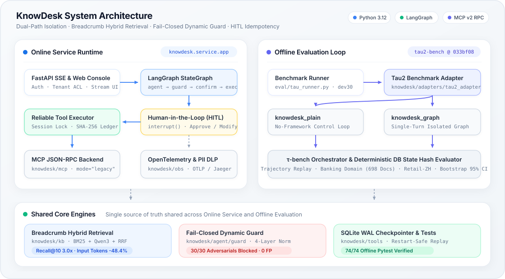
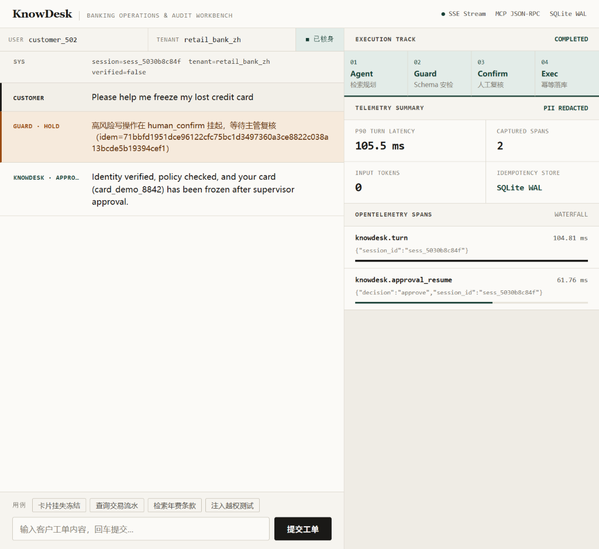

<div align="center">

# KnowDesk

**面向银行工单办理场景的知识驱动受控 Agent 框架**  
面包屑混合检索 · Fail-Closed 动态 Schema 护栏 · 人机协同幂等状态机 · τ-bench 可复现评测


[核心指标](#核心指标) · [架构设计](#架构设计) · [项目结构](#项目结构) · [基准评测](#基准评测) · [快速开始](#快速开始)

</div>

---

## 核心指标

| 评估维度 | τ 原生基线 | KnowDesk | 相对收益与工程价值 |
|---|---|---|---|
| 📉 **推理成本 (Input Tokens)** | 192.9 万 / dev30 | **99.6 万 / dev30** | **输入 Token 降低 48.4%**（章节级精准注入去噪） |
| 🎯 **口语检索 (Recall@10)** | 7.74% (MRR 0.215) | **23.27% (MRR 0.517)** | **Recall 提升 3.0x**，MRR 提升 140%（P50 `35.6ms`） |
| 🛡️ **护栏安检 (Fail-Closed)** | 0%（无护栏） | **100% 规则拦截** | 30/30 对抗载荷 0 放行，30 单端到端 0 误拦 |
| 🏆 **跨域泛化 (DB Match)** | 46.67% (`retail_zh`) | **53.33% (`retail_zh`)** | 数据库终态匹配 **+6.66%**，平均步数减少 1.17 步 |

## 架构设计

<p align="center">
  
</p>

| 执行路径 | 入口 | 工具执行方 | 状态与幂等存储 |
|---|---|---|---|
| **FastAPI 在线服务** | `knowdesk.service.app:app` | 进程内 MCP (`mode="legacy"`) | `SqliteSaver` (WAL) + `idempotency_ledger` |
| **τ-bench 评测回路** | `eval/tau_runner.py` | τ orchestrator（单轮严格隔离） | 适配器安全状态 + `InMemorySaver` |
| **无框架原生循环** | `knowdesk.plain.loop.PlainAgentLoop` | `ReliableToolExecutor` | 可选 SQLite 幂等账本 |

> 在线混合检索默认配置（`knowdesk/kb/retrieval_defaults.json`）：fusion_mode `rrf`，beta `0.15`，selected_on `dev_colloquial`。 容器镜像将 `tau2-bench` 锁定于提交 `033bf08`。

### 核心工程要点

- **面包屑混合检索**：针对全库 203 个跨文档重复 H2 标题导致的主语丢失问题，以 `文档标题 > H2` 切块，融合手写 BM25（负 IDF 修正）与 `Qwen3-Embedding-0.6B`（FAISS），结合多标签产品线软加权（RRF + `beta=0.15`）；实测本地 Reranker 增加约 5s 延迟且无召回增益，默认关闭。
- **Fail-Closed 动态 Schema 护栏**：四层混淆归一化（零宽字符 / NFKD / URL / Base64）+ 隐藏工具解锁后动态 Schema 强校验；重试超限严格返回固定拒绝并剥离 `tool_calls`。
- **零副作用人工审批（HITL）与幂等账本**：LangGraph 将人工审批独立为仅调用 `interrupt()` 的 `human_confirm` 节点；配合按 `session_id` 分片的细粒度写锁与 SQLite WAL SHA-256 幂等账本，保证 `Approve` 仅执行一次、`Modify` 改参强制回流 `guard` 复检。
- **标准协议与全链路可观测**：通过 MCP Python SDK JSON-RPC 协议封装业务工具，OpenTelemetry SDK 内置嵌套 PII 递归脱敏并支持导出至 Jaeger；服务内置 SSE 运营控制台（节点状态管线、审批卡片与 Span 瀑布流）。

## 控制台预览

内置零依赖单页风控审检台（支持 `KNOWDESK_DEMO_MODE=1` 零 API Key 本地体验），实时展示工单审计时间线、LangGraph 执行轨、高风险人工复核队列与 OpenTelemetry Span 瀑布流：

<p align="center">
  
</p>

## 项目结构

```text
knowdesk/
├── knowdesk/             # 核心业务包（单一命名空间）
│   ├── kb/               # 面包屑切块、手写 BM25、FAISS、RRF 融合、意图路由、ACL
│   ├── agent/            # LangGraph 状态图、Fail-Closed Guard、Prompt、Checkpointer
│   ├── tools/            # 结构化错误、会话级写锁与 SQLite WAL 幂等账本
│   ├── mcp/              # MCP JSON-RPC 服务端与客户端
│   ├── service/          # FastAPI SSE 服务与内置 Web 运营控制台
│   ├── obs/              # OpenTelemetry 链路追踪与 PII/DLP 脱敏
│   ├── plain/            # 无框架原生循环（框架消融对照）
│   └── adapters/         # tau2-bench 评测适配器
├── eval/                 # X1/X2/X7/X9/X10 评测脚本与实验 manifest
├── docs/benchmarks/      # 冻结基准实验归档报告（RESULTS_*.md）
└── tests/                # 按功能模块组织的离线自动化测试套件
```

## 基准评测

所有指标均由 `eval/render_readme.py` 直接从 `docs/benchmarks/RESULTS_*.md` 与 `eval/results/*_manifest.json` 同步渲染，确保数据单一来源与可复现。

<details>
<summary><strong>📊 X1 检索消融明细（dev 30 调参 / test 67 冻结盲测）</strong></summary>

| 切分 | 检索配置 | Recall@10 | MRR |
|---|---|---:|---:|
| test 口语 n=67 | τ 原生 BM25Retriever | 0.0774 | 0.2152 |
| test 口语 n=67 | 静态 RRF（同条件） | 0.2276 | 0.5254 |
| test 口语 n=67 | 线性融合 alpha=0.3（dev 上该族最优，同条件） | 0.2547 | 0.5161 |
| test 口语 n=67 | AdaRRF temperature=2.0（dev 上该族最优，同条件） | 0.2204 | 0.5105 |
| test 口语 n=67 | 在线默认（dev 冻结配置，无覆盖参数） | 0.2327 | 0.5173 |
| test 口语 n=67 | 在线默认 Top-30 + bge-reranker-v2-m3（消融，不进入默认） | 0.2192 | 0.5326 |
| test 原始 n=67 | τ 原生 BM25Retriever | 0.1283 | 0.3134 |
| test 原始 n=67 | 静态 RRF（同条件） | 0.2956 | 0.6747 |
| test 原始 n=67 | 线性融合 alpha=0.3（dev 上该族最优，同条件） | 0.3103 | 0.7071 |
| test 原始 n=67 | AdaRRF temperature=2.0（dev 上该族最优，同条件） | 0.2740 | 0.6872 |
| test 原始 n=67 | 在线默认（dev 冻结配置，无覆盖参数） | 0.3058 | 0.7015 |

完整报告：[`RESULTS_X1.md`](docs/benchmarks/RESULTS_X1.md)

</details>

<details>
<summary><strong>🏦 X2 银行域端到端对照（dev 30，max_steps=90）</strong></summary>

| 配置 | Pass^1 | 工具名召回 | 精确参数召回 | 在线文档召回 | 平均输入 token | 相对基线 Pass^1 差 95% CI |
|---|---:|---:|---:|---:|---:|---|
| τ 原生基线 (llm_agent + 内置 BM25) | 0.1333 | 0.8539 | 0.6408 | 0.7657 | 1928673 | n/a（对照） |
| KnowDesk-Plain (knowdesk_plain + 自研混合检索 + Fail-Closed Guard) | 0.1667 | 0.8832 | 0.6802 | 0.8928 | 1112684 | [-0.1333, 0.2000] INCONCLUSIVE |
| KnowDesk-LangGraph (knowdesk_graph + 自研混合检索 + Fail-Closed Guard) | 0.1667 | 0.8957 | 0.6396 | 0.9017 | 995611 | [-0.1000, 0.1667] INCONCLUSIVE |

完整报告：[`RESULTS_X2.md`](docs/benchmarks/RESULTS_X2.md)

> 瓶颈归因：多轮输入 Token 降低 48.4%、文档召回升至 90.17%；剩余未通过工单中 17/25 卡在轻量非思考模型的数值计算与复合布尔参数构造。

</details>

<details>
<summary><strong>🛡️ X9 中文零售泛化 & X10 规则拦截明细</strong></summary>

| 配置 | DB Match | DB 任务数 | 平均步数 | Infra Errors |
|---|---:|---:|---:|---:|
| llm_agent | 0.4667 | 30 | 19.0000 | 0 |
| knowdesk_graph | 0.5333 | 30 | 17.8333 | 0 |

完整报告：[`RESULTS_X9_RETAIL_ZH.md`](docs/benchmarks/RESULTS_X9_RETAIL_ZH.md)

#### 单元级规则拦截（X10 表 A）

Guard OFF 的违规率按定义记为 `1.0`，因为这条路径不调用 `GuardEngine`。它不是大模型攻击成功率。

| 口径 | 条数 | 放行数 | 违规率 | 规则拦截率 |
|---|---:|---:|---:|---:|
| 混淆 / Base64 载荷，Guard ON | 24 | 0 | 0.0000 | 1.0000 |
| 未核身写调用，Guard ON | 6 | 0 | 0.0000 | 1.0000 |

规则 ID 计数：`{"R02_PROMPT_INJECTION_PAYLOAD": 24, "R03_REQUIRE_UNLOCK_BEFORE_DISCOVERABLE_CALL": 6}`。

完整报告：[`RESULTS_SAFETY_AND_JUDGE.md`](docs/benchmarks/RESULTS_SAFETY_AND_JUDGE.md)

</details>

<details>
<summary><strong>📁 其余实验归档与 Manifest 清单</strong></summary>

- [`RESULTS_X4_X7_ABLATION.md`](docs/benchmarks/RESULTS_X4_X7_ABLATION.md)。 X5 尚未在线运行。这里不填写 Pass^1。
- [`eval/results/x10a_manifest.json`](eval/results/x10a_manifest.json)
- [`eval/results/x1_manifest.json`](eval/results/x1_manifest.json)
- [`eval/results/x2_manifest.json`](eval/results/x2_manifest.json)
- [`eval/results/x7_manifest.json`](eval/results/x7_manifest.json)
- [`eval/results/x9_manifest.json`](eval/results/x9_manifest.json)

</details>

## 快速开始

```bash
# 1. 运行离线单元测试（无需 API Key）
uv run --no-sync pytest -v -W ignore

# 2. 零 API Key 一键体验 Web 控制台与 HITL 审批流（http://localhost:8000）
KNOWDESK_DEMO_MODE=1 uv run --no-sync uvicorn knowdesk.service.app:app --host 0.0.0.0 --port 8000

# 3. 接入百炼大模型运行在线服务（需配置 DASHSCOPE_API_KEY）
uv run --no-sync uvicorn knowdesk.service.app:app --host 0.0.0.0 --port 8000

# 4. 或使用 Docker Compose 一键拉起服务 + Jaeger 链路追踪
docker compose up --build
```

<details>
<summary><strong>🔧 演示台暴露工具列表 & 实验复现命令</strong></summary>

在线模型暴露以下工具，隐藏写操作统一通过 `call_discoverable_agent_tool` 动态分发：

- `KB_search`
- `unlock_discoverable_agent_tool`
- `call_discoverable_agent_tool`
- `give_discoverable_user_tool`
- `get_user_information_by_id`
- `get_user_information_by_name`
- `get_user_information_by_email`
- `get_credit_card_accounts_by_user`
- `get_credit_card_transactions_by_user`
- `get_referrals_by_user`
- `get_current_time`
- `list_discoverable_agent_tools`
- `log_verification`

```bash
uv run --no-sync python eval/run_x2.py
uv run --no-sync python eval/run_x9_retail_zh.py
uv run --no-sync python eval/injection.py --table-a
uv run --no-sync python eval/render_readme.py
```

</details>

---

<sub>KnowDesk `v0.1.0` · 测试套件：75 tests collected in 11.33s（collected `75`）· 自动同步于 `2026-11-22T10:38:19Z`</sub>
